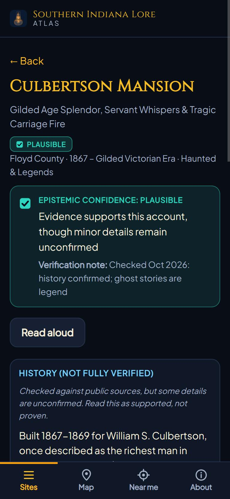
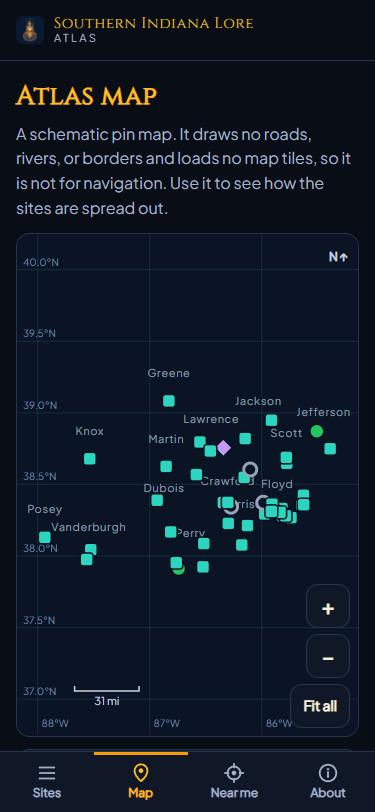
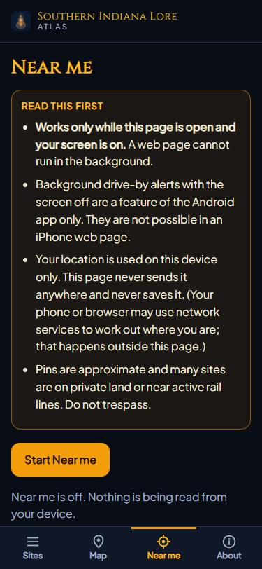

# Southern Indiana Lore

[](https://android.com)
[](https://kotlinlang.org)
[](https://developer.android.com/jetpack/compose)
[](https://developer.android.com/training/data-storage/room)
[](#license)
[](https://github.com/Wommper1/southern-indiana-lore/actions/workflows/android-ci.yml)

A location-aware, offline-first native Android application by **Alex Shade Productions**. 

Southern Indiana Lore brings folklore, haunted legends, Underground Railroad routes, Monon rail tunnels, early Indiana statehood milestones, and forgotten Ohio River riverboat disasters to life. The bundled pack covers 52 sites across 17 southern Indiana counties, centered on Floyd, Clark, Harrison, Lawrence, and Crawford. All 52 have been checked against public sources and corrected where they were wrong, though most are only badged Plausible and a few found nothing to support them; each site's badge says how far to trust it (see [docs/VERIFICATION_LOG.md](docs/VERIFICATION_LOG.md)). As you drive or walk, the background GPS engine detects proximity to historical points of interest and triggers narration and archival accounts.

---

## Try it

You need an Android 7.0 or newer phone. No account and no internet connection are needed.

1. **Install.** Download the APK from the repository's Releases page, allow installs from your browser or file manager when Android asks, then open the file. It is not on Google Play, so Android will warn that the app is from an unknown source. To check the download, compare its SHA-256 with the one in the release notes (`Get-FileHash app.apk` in PowerShell, or `sha256sum app.apk` elsewhere).
2. **First run.** Allow location and notifications when asked. "While using the app" is enough for a quick look; "Allow all the time" is only needed for alerts with the screen off during a tour. The microphone prompt appears only when you use the Oral History Tape Deck.
3. **Demo without leaving your chair.** Open the **Tour** tab in the bottom dock, find **Desk & Tabletop Mode**, and tap **Simulate Route**. The app walks a pretend location through nine New Albany-area sites, about four seconds each, so nearby sites should trigger their alerts and narration as it goes. Tap **Stop Sim** to end it.
4. **Look around.** The dock has six tabs: Desk, Radar, Tour, Library, Relics, and Pack. Tap any site to see its history, folklore, sources, and a confidence badge showing how thoroughly it has been verified.

**On an iPhone or iPad?** There is no iPhone app. A free web edition, the [Southern Indiana Lore Atlas](https://wommper1.github.io/southern-indiana-lore/), runs in Safari and works offline once opened. It is a beta that has not yet been tried on a real iPhone, and its "Near me" mode only works while the page is open and the screen is on; background drive-by alerts are a feature of the Android app.

<p align="center">
  
  
  
</p>
<p align="center"><em>The web atlas on a phone: a site page with its trust badge, the schematic map, and the Near me page.</em></p>

---

## Key Features

- **Spatial Indexing & Multi-Tier Proximity Geofencing**:
  - Uses bounding-box spatial indexing in Room SQLite to evaluate candidate POIs with low CPU and battery overhead.
  - Multi-tier alert stages: *Horizon Approaching* (500m), *Immediate Lore Trigger* (150m), and *Inside Site Geofence*.
- **Background Tour Service (`LoreTourForegroundService`)**:
  - Continuous location monitoring in the background while driving or walking with device in pocket.
  - Real-time notification updates with site distance, bearing, and immediate narration trigger actions.
- **Dynamic Multi-Persona Narration Engine**:
  - **Chief Historical Archivist**: Scholarly historical analysis.
  - **Folklore Sage**: Fireside storyteller of Appalachian and Ohio Valley legends.
  - **Adventure Chronicler**: Resonant frontier documentary dispatch style.
  - **Karst Alchemist & Lore Wizard**: Arcane, geological perspective of Indiana limestone caves.
  - **Retro Radio (1948)**: Nostalgic, vintage Mid-Century AM broadcast style.
- **Offline-First SQLite Architecture**:
  - Bundled lore pack of Southern Indiana historical sites with coordinates, per-site source citations, and a confidence badge on every entry that says how thoroughly it has been verified (Official Source, Plausible, Unverified, Folk Legend, and so on).
  - User Field Journal: add personal field notes, coordinates, and custom sites offline.
- **On-Device Map**:
  - Pan/zoom map drawn entirely on the device, with your position, site markers, and historical overlays on top. The base layer is deliberately minimal: a dark schematic with the Ohio River, Silver Creek, a Knobstone ridgeline, and one historic road/rail corridor. It has no street data, place names, or hill shading, so use the "Navigate" buttons for directions.
- **Oral History Tape Deck**:
  - Record voice memos on the device and tag them to sites. Recording starts only when you press Record.
- **Field Expedition Dossier & GPX 1.1 Exporter**:
  - Export collected discoveries, field notes, and encounters into formatted Markdown (`.md`) dossiers.
  - Generate standard GPX 1.1 XML waypoints for Garmin GPS units, OsmAnd, QGIS, and Google Earth.
- **Offline Archivist**:
  - Ask about a featured site or request a driving-tour route. This is a keyword lookup over hand-written entries, not an AI model: well-known sites get a curated answer, and everything else gets a general overview.
- **Automated GitHub Actions CI/CD**:
  - Continuous integration running the automated test suites and Android lint on JDK 21, with Dependabot keeping dependencies current.
  - Version tags (`v*`) build a debug APK and attach it to a GitHub Release for sideloading.

---

## Known limitations

This is an early release. Please read these before judging it.

- **Limited device testing.** The automated tests pass, and the owner has tried the app on one real phone, a Samsung Galaxy S25 Ultra, with no problems noted so far. Other phones, tablets, and foldables are untested, so expect rough edges. The layout was designed around that kind of large modern phone.
- **The history is only partly confirmed.** All 52 entries were compared with public sources (not archival records) and corrected where they were wrong, but most (41) are only badged **Plausible**: the main facts matched, and other details were not confirmed. Four were checked without finding anything to support them (badged **Unverified**), and several are folklore. Details can still be wrong. See [docs/VERIFICATION_LOG.md](docs/VERIFICATION_LOG.md), and please report mistakes with a source.
- **The map is minimal.** See "On-Device Map" above. It is not a navigation map.
- **No backup.** Journal entries, custom sites, and voice memos stay on the phone and are lost if you uninstall the app or switch phones. Export a dossier first if you want to keep them.
- **The Archivist is not an AI.** It looks up hand-written answers for a few well-known sites.
- **Battery savers can silence tours.** Some phones stop background apps aggressively. If alerts stop with the screen off, exclude the app from battery optimization.
- **Be careful out there.** Many sites are on private land or active rail lines (the tunnels, for example). The app's alerts are not directions or permission to go anywhere; use public viewpoints and obey posted signs and the law.

---

## Security & Privacy Architecture

| Security Vector | Implementation Detail |
| :--- | :--- |
| **Zero External Secrets** | No API keys, tokens, or credentials are used or compiled into the app. Signing keys are never committed (`*.jks` / `*.keystore` are git-ignored). |
| **No Network Access** | The app declares no `INTERNET` permission. Map tiles, narration audio, and sound are generated on-device. "Navigate" buttons and source links hand off to Google Maps or your browser. |
| **Permission Least-Privilege** | Location (fine, coarse, background), notifications, foreground service (location), vibrate, and microphone. The microphone is used only for the Oral History Tape Deck; the camera is not used. |
| **Android Component Isolation** | Foreground Service and Broadcast Receiver are non-exported (`android:exported="false"`). |
| **Data Privacy** | No ad networks, telemetry, or analytics SDKs. Android backup and device-transfer are disabled, so journal entries, custom sites, and voice memos stay on the device. |

One caveat: field-note voice dictation (`RecognizerIntent`) and spoken narration (Android text-to-speech) use your phone's system speech services. Depending on your device and settings, those services may use the network. The app itself makes no network calls.

---

## Project Structure

```
southern-indiana-lore/
├── app/
│   ├── src/
│   │   ├── main/
│   │   │   ├── java/com/example/
│   │   │   │   ├── data/
│   │   │   │   │   ├── archivist/        # Offline keyword-lookup Archivist
│   │   │   │   │   ├── local/            # Room Database, DAOs, Entities, Seed data
│   │   │   │   │   ├── model/            # LoreSite, HistoricalArchive domain models
│   │   │   │   │   ├── pack/             # Lore pack validation & integrity (SHA-256)
│   │   │   │   │   └── repository/       # LoreRepository data layer
│   │   │   │   ├── service/              # LoreTourForegroundService, SpatialProximityCoordinator
│   │   │   │   ├── ui/                   # Jetpack Compose Screens, Dialogs, Theme
│   │   │   │   └── util/                 # Audio engine, sound synthesis, TTS, notifications
│   │   │   ├── assets/lorepacks/         # Bundled lore pack, geofences, schema, licenses
│   │   │   ├── res/                      # Android resources (drawables, fonts, values)
│   │   │   └── AndroidManifest.xml       # Least-privilege manifest declaration
│   └── build.gradle.kts                  # App build & dependency specifications
├── docs/                                 # Design notes, verification log, map architecture, publishing guide
├── scripts/                              # update_pack_manifest.py (lore pack hashes), build_site_data.py and serve_site.py (web atlas)
├── site/                                 # Web atlas: the lore pack as a plain HTML/CSS/JS website (not hosted yet)
├── tests/site/                           # Node tests for the web atlas
├── .github/                              # CI workflow, Dependabot, issue and pull request templates
├── CHANGELOG.md                          # What changed in each release
├── CONTRIBUTING.md                       # How to help (especially fact-checking)
├── LICENSE                               # MIT
├── .gitignore                            # Ignore rules (keystores, build output, local config)
├── README.md                             # Repository documentation
└── settings.gradle.kts                   # Project configuration
```

---

## Getting Started

### Prerequisites

- **Android Studio**: a current stable release (the project uses Android Gradle Plugin 9.1.1)
- **JDK**: Java 21+
- **Android SDK**: Compile SDK 36, Minimum SDK 24 (Android 7.0+)

### Building Locally

1. **Clone the repository**:
   ```bash
   git clone https://github.com/Wommper1/southern-indiana-lore.git
   cd southern-indiana-lore
   ```

2. **Zero Configuration Required**:
   No API keys, cloud setup, or network access are needed.

3. **Build the Debug APK**:
   ```bash
   ./gradlew assembleDebug
   ```

4. **Run Unit & Robolectric Tests**:
   ```bash
   ./gradlew testDebugUnitTest
   ```

5. **Run Android Lint** (optional; the report is written to `app/build/reports/`):
   ```bash
   ./gradlew lintDebug
   ```

### Installing a Build

Each release's notes list the APK's SHA-256. The signed release APK is uploaded by hand; tagged builds from CI attach a debug APK as well. To sideload one, allow installs from your browser or file manager in Android settings, then open the APK. Debug builds use the application ID suffix `.debug`, so they install alongside the release build.

---

## Authors & Attribution

Created by **Alex Shade Productions**.  
Historical details come from the sources cited on each site. The citations that shipped with the original data were not independently verified; [docs/VERIFICATION_LOG.md](docs/VERIFICATION_LOG.md) records what has been checked since.

---

## Contributing

Corrections with a source are the most useful contribution. See [CONTRIBUTING.md](CONTRIBUTING.md), and use the issue templates for bug reports and data corrections. Release history is in [CHANGELOG.md](CHANGELOG.md).

---

## License

- **Source code and the app's artwork** (hero image, app icon, intro video): MIT, see [LICENSE](LICENSE).
- **Lore pack** (`app/src/main/assets/lorepacks/`): CC BY-SA 4.0, as declared in [`licenses.json`](app/src/main/assets/lorepacks/southern_indiana/licenses.json).
- **Bundled fonts** (Cinzel, Plus Jakarta Sans) are under the SIL Open Font License. See [THIRD_PARTY_NOTICES.md](THIRD_PARTY_NOTICES.md).
